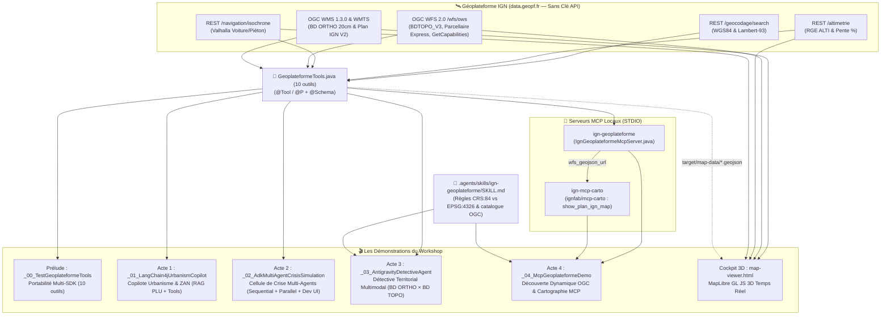
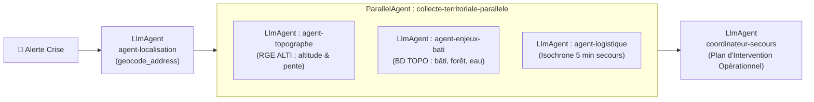
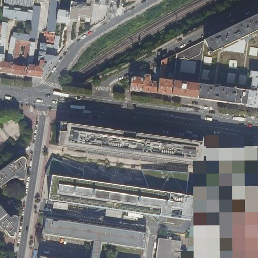
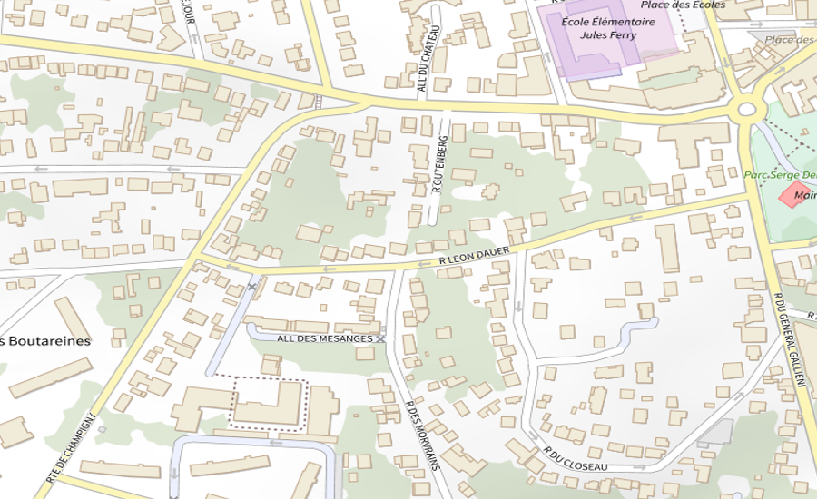
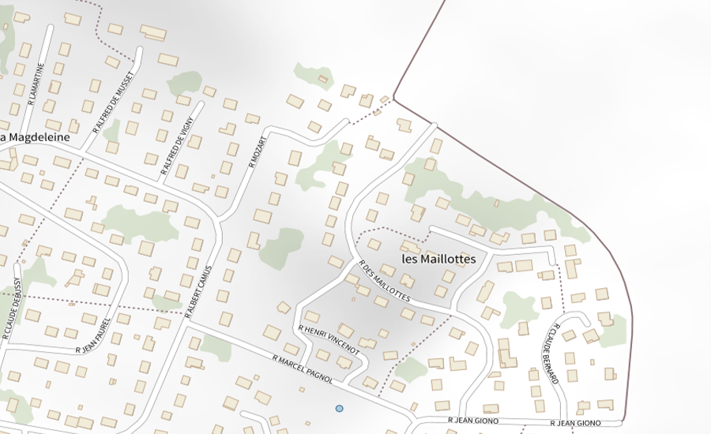
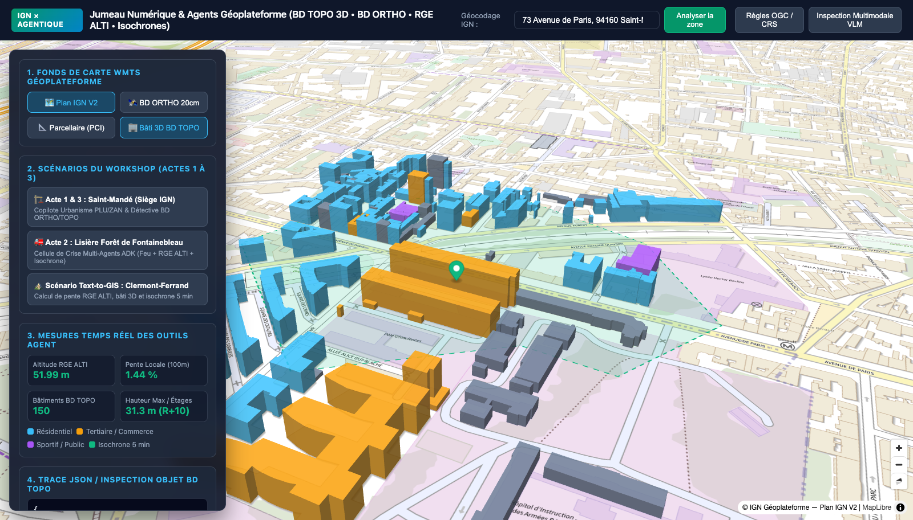
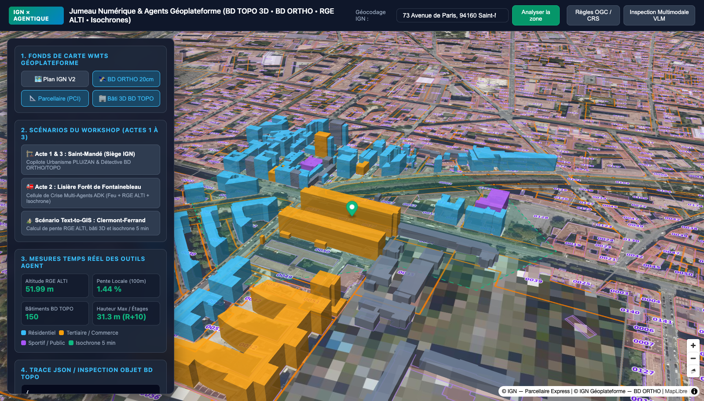
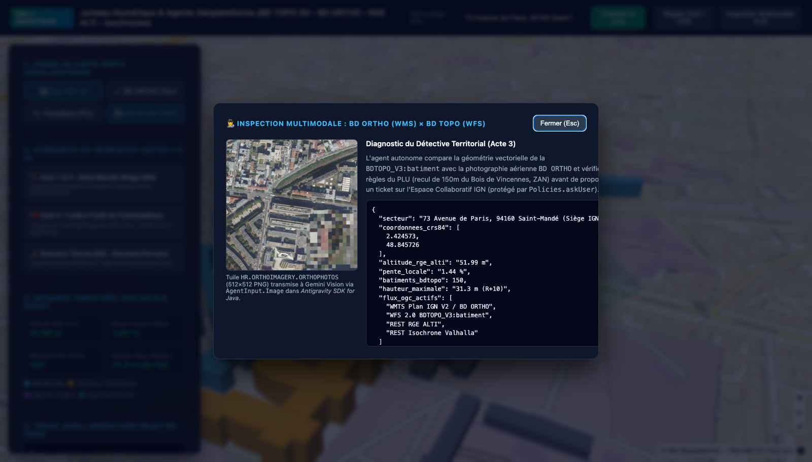

# 🌍 Workshop IGN : Développement Agentique & Systèmes Multi-Agents Géospatiaux

Support de présentation, architecture technique et démonstrations live pour l'**Institut national de l'information géographique et forestière (IGN)** — Session de 2 heures pour développeurs.

Ce dépôt présente l'architecture complète, le catalogue des **10 outils géospatiaux**, le détail des **5 programmes Java** et du **Cockpit Cartographique 3D** connectés aux **APIs ouvertes de la Géoplateforme IGN (`data.geopf.fr`, sans clé API)**, ainsi que les **traces réelles d'exécution** avec `gemini-3.8-flash`.

---

## 1. Vue d'ensemble de l'Architecture

L'ensemble du workshop repose sur **une seule classe d'outils Java** ([`GeoplateformeTools.java`](src/main/java/fr/ign/workshop/tools/GeoplateformeTools.java)) exposant **10 outils géospatiaux** réutilisés **sans aucune modification** à travers :
1. **LangChain4j** (`@Tool` / `@P`),
2. **Google ADK for Java** (`@Schema` / `FunctionTool`),
3. **Antigravity SDK for Java** (réflexion Tier-3 zéro-dépendance),
4. **Deux serveurs MCP locaux (`STDIO`)** :
   - `ign-geoplateforme` ([`IgnGeoplateformeMcpServer.java`](src/main/java/fr/ign/workshop/mcp/IgnGeoplateformeMcpServer.java)) pour l'interrogation REST & OGC (WFS 2.0 / WMS 1.3.0) et la découverte dynamique du catalogue Géoplateforme,
   - `ign-mcp-carto` ([`mcp/mcp-carto`](mcp/mcp-carto), serveur officiel `ignfab/mcp-carto` de l'IGN Fab) pour l'affichage cartographique `Plan IGN v2` / `BD ORTHO` avec superposition directe des flux GeoJSON WFS,
5. Un **Agent Skill OGC/IGN** ([`.agents/skills/ign-geoplateforme/SKILL.md`](.agents/skills/ign-geoplateforme/SKILL.md)) documentant les règles de projection (`CRS:84` vs `EPSG:4326` vs `EPSG:2154`) et les noms techniques des couches de la Géoplateforme.



---

## 2. Catalogue des 10 Outils de [`GeoplateformeTools.java`](src/main/java/fr/ign/workshop/tools/GeoplateformeTools.java)

La classe [`GeoplateformeTools.java`](src/main/java/fr/ign/workshop/tools/GeoplateformeTools.java) centralise les appels aux services web ouverts de la Géoplateforme (`https://data.geopf.fr`). Chaque méthode porte simultanément les annotations `@Tool` / `@P` (LangChain4j & Antigravity SDK Tier-3) et `@Schema` (Google ADK Java), et est également exposée sur le serveur MCP `ign-geoplateforme`.

### 2.1 Outils Métier Géoplateforme (7 outils spécialisés)

| # | Nom de l'outil (`@Tool` / MCP) | Méthode Java & Paramètres | Service Géoplateforme (`data.geopf.fr`) | Données retournées & Export local |
| :-: | :--- | :--- | :--- | :--- |
| **1** | `geocode_address` | [`geocodeAddress(query)`](src/main/java/fr/ign/workshop/tools/GeoplateformeTools.java#L56-L103) | **REST Géocodage BAN/IGN**<br/>`GET /geocodage/search` | Adresse normalisée, coordonnées **WGS84** (`lon`, `lat` en `CRS:84`), coordonnées projetées **Lambert-93** (`lambert93_x`, `lambert93_y` en `EPSG:2154`), code INSEE et score de confiance. |
| **2** | `get_elevation_and_slope` | [`getElevationAndSlope(lon, lat)`](src/main/java/fr/ign/workshop/tools/GeoplateformeTools.java#L109-L180) | **REST Altimétrie RGE ALTI**<br/>`GET /altimetrie/1.0/calcul/alti/rest/elevation.json`<br/>(`ign_rge_alti_wld`) | Échantillonne 5 points (centre + N/S/E/O à $50\text{ m}$), calcule l'**altitude NGF** en mètres, le **gradient de pente locale (%)**, la catégorie de pente (`FAIBLE`, `MODÉRÉE`, `FORTE`) et le sens d'écoulement gravitaire / montée thermique. |
| **3** | `compute_isochrone` | [`computeIsochrone(lon, lat, durationSeconds, profile)`](src/main/java/fr/ign/workshop/tools/GeoplateformeTools.java#L186-L255) | **REST Navigation / Isochrone**<br/>`GET /navigation/isochrone`<br/>(`bdtopo-valhalla`, `car` ou `pedestrian`) | Enveloppe d'accessibilité en km (Est-Ouest × Nord-Sud), nombre de sommets du polygone, `bbox_crs84` et sauvegarde dans `target/map-data/isochrone.geojson`. |
| **4** | `query_bdtopo_buildings` | [`queryBdTopoBuildings(lon, lat, radiusMeters)`](src/main/java/fr/ign/workshop/tools/GeoplateformeTools.java#L261-L346) | **OGC WFS 2.0 BD TOPO V3**<br/>`GET /wfs/ows`<br/>(`TYPENAMES=BDTOPO_V3:batiment`, `SRSNAME=CRS:84`) | Nombre total de bâtiments dans le rayon, ventilation par usage (`usage_1`), hauteur maximale (`hauteur`), nombre d'étages max, total de logements, échantillon détaillé (`cleabs`, `rnb_id`), `wfs_geojson_url` et sauvegarde dans `target/map-data/buildings.geojson`. |
| **5** | `query_bdtopo_environment` | [`queryBdTopoEnvironment(lon, lat, radiusMeters)`](src/main/java/fr/ign/workshop/tools/GeoplateformeTools.java#L352-L427) | **OGC WFS 2.0 BD TOPO V3**<br/>`BDTOPO_V3:zone_de_vegetation` & `BDTOPO_V3:cours_d_eau` | Recensement des massifs boisés, forêts, haies (`has_forest_or_wood_nearby`) et des cours d'eau dans un rayon élargi de $500\text{ m}$ (`toponyme`, `cleabs`), avec sauvegarde dans `target/map-data/vegetation.geojson`. |
| **6** | `download_bdortho_aerial_image` | [`downloadBdOrthoAerialImage(lon, lat, radiusMeters)`](src/main/java/fr/ign/workshop/tools/GeoplateformeTools.java#L433-L490) | **OGC WMS 1.3.0 BD ORTHO 20 cm**<br/>`GET /wms-r/wms`<br/>(`LAYERS=HR.ORTHOIMAGERY.ORTHOPHOTOS`, `CRS=CRS:84`) | Télécharge une prise de vue aérienne haute résolution **512×512 PNG** centrée sur `(lon, lat)` dans `target/map-data/bd_ortho_tile.png` pour l'inspection multimodale par Gemini Vision. |
| **7** | `submit_bdtopo_collaborative_report` | [`submitBdTopoCollaborativeReport(cleabsOrLocation, anomalyType, technicalReport)`](src/main/java/fr/ign/workshop/tools/GeoplateformeTools.java#L496-L532) | **Espace Collaboratif IGN (Simulation d'écriture gouvernée)** | **Action sensible** soumise à validation humaine (`SecurityPolicy`) dans l'Acte 3 : génère un ticket horodaté (`IGN-COLLAB-XXXXX`) et l'enregistre dans `target/map-data/collaborative-ticket.json`. |

### 2.2 Outils d'Introspection Dynamique OGC WFS 2.0 (3 outils génériques)

Ces 3 outils permettent à un agent de découvrir et d'interroger **à la volée** n'importe laquelle des dizaines de couches vectorielles publiées sur la Géoplateforme sans écrire de code Java spécifique (parcellaire cadastral, limites administratives, réseau routier, occupation du sol, etc.) :

| # | Nom de l'outil (`@Tool` / MCP) | Méthode Java & Paramètres | Requête OGC WFS 2.0 (`data.geopf.fr/wfs/ows`) | Rôle pour l'Agent |
| :-: | :--- | :--- | :--- | :--- |
| **8** | `search_wfs_layers` | [`searchWfsLayers(keyword)`](src/main/java/fr/ign/workshop/tools/GeoplateformeTools.java#L538-L593) | `REQUEST=GetCapabilities` | Filtre par mot-clé (`parcelle`, `commune`, `route`, `foret`, `hydro`...) le catalogue XML `GetCapabilities` et retourne les couples `(typeName, title)`. |
| **9** | `describe_wfs_layer_schema` | [`describeWfsLayerSchema(typeName)`](src/main/java/fr/ign/workshop/tools/GeoplateformeTools.java#L595-L633) | `REQUEST=DescribeFeatureType&TYPENAMES=...&OUTPUTFORMAT=application/json` | Inspecte dynamiquement la structure d'une couche WFS et retourne la liste exacte de ses attributs et types (`string`, `int`, `MultiPolygon`...). |
| **10** | `query_any_wfs_layer` | [`queryAnyWfsLayer(typeName, lon, lat, radiusMeters, limit)`](src/main/java/fr/ign/workshop/tools/GeoplateformeTools.java#L635-L688) | `REQUEST=GetFeature&TYPENAMES=...&SRSNAME=CRS:84&BBOX=...,CRS:84` | Interroge n'importe quelle couche WFS dans un rayon en mètres autour de `(lon, lat)` et retourne à la fois les propriétés JSON des entités (`features_properties`) et l'URL directe du flux GeoJSON (`wfs_geojson_url`) consommable par `show_plan_ign_map` (`ign-mcp-carto`). |

---

## 3. Synthèse des Développements & Particularités Techniques

| Composant | Détail technique | Fichiers concernés |
| :--- | :--- | :--- |
| **Boîte à outils Géoplateforme (10 outils)** | Combinaison des 7 outils métier et des 3 outils d'introspection dynamique OGC WFS 2.0 (`search_wfs_layers`, `describe_wfs_layer_schema`, `query_any_wfs_layer`), avec enrichissement des réponses WFS via `wfs_geojson_url` pour le chaînage direct vers `ign-mcp-carto`. | [`GeoplateformeTools.java`](src/main/java/fr/ign/workshop/tools/GeoplateformeTools.java) |
| **Acte 1 — LangChain4j & Gemini 3** | Configuration explicite de `.toolArgumentsErrorHandler(ToolArgumentsErrorHandler.sendExceptionMessageToLlm())` et `.toolExecutionErrorHandler(ToolExecutionErrorHandler.failInvocationUnlessVisibleToLlm())`, et activation de `.returnThinking(true)` / `.sendThinking(true)` pour la prise en charge des `thought_signature` de `gemini-3.8-flash`. | [`_01_LangChain4jUrbanismCopilot.java`](src/main/java/fr/ign/workshop/_01_LangChain4jUrbanismCopilot.java) |
| **Acte 2 — Google ADK Java & Dev UI** | Arrêt propre des pools de threads non-daemons (`Schedulers.shutdown()` + `System.exit(0)`) en mode console ; support de `AdkWebServer` (`--ui`) sur `http://localhost:8080/dev-ui/` avec redirection automatique depuis `/` ([`static/index.html`](src/main/resources/static/index.html)) et résolution de `GOOGLE_API_KEY`. | [`_02_AdkMultiAgentCrisisSimulation.java`](src/main/java/fr/ign/workshop/_02_AdkMultiAgentCrisisSimulation.java), [`index.html`](src/main/resources/static/index.html), [`logback.xml`](src/main/resources/logback.xml) |
| **Acte 4 — MCP STDIO & Inférence Locale Open-Weights (Gemma 4)** | Chaînage des deux serveurs MCP locaux (`ign-geoplateforme` + `ign-mcp-carto`) exécutable soit avec Gemini, soit **100 % en local sur le poste (On-Device)** avec **Gemma 4 (`gemma4-e2b`, modèle *open weights* de 1,9 Go)** via **LiteRT-LM** (`LiteRTAgentConfig` sur GPU Metal) sans qu'aucune donnée ni requête LLM ne parte vers un cloud tiers étranger. Démarrage et arrêt automatiques de `litert-lm serve` intégrés à la démo. | [`_04_McpGeoplateformeDemo.java`](src/main/java/fr/ign/workshop/_04_McpGeoplateformeDemo.java), [`mcp_config.json`](.agents/plugins/ign-geoplateforme-plugin/mcp_config.json), [`.gemini/settings.json`](.gemini/settings.json), [`run-ign-mcp-server.sh`](mcp/run-ign-mcp-server.sh), [`run-ign-mcp-carto.sh`](mcp/run-ign-mcp-carto.sh) |

---

## 4. Prélude : Portabilité Multi-SDK & Test des Flux Géoplateforme

* **Programme** : [`_00_TestGeoplateformeTools.java`](src/main/java/fr/ign/workshop/_00_TestGeoplateformeTools.java)
* **Commandes d'exécution** :
  ```bash
  # Exécution du programme de vérification :
  ./mvnw compile exec:java -Dexec.mainClass="fr.ign.workshop._00_TestGeoplateformeTools"

  # Ou via la suite de tests automatisés JUnit 6 :
  ./mvnw test
  ```
* **Explication** :
  Vérifie par introspection que la classe [`GeoplateformeTools.java`](src/main/java/fr/ign/workshop/tools/GeoplateformeTools.java) expose bien ses **10 outils** simultanément à :
  1. `ToolSpecifications.toolSpecificationsFrom(tools)` (**LangChain4j**)
  2. `FunctionTool.create(tools, ...)` (**Google ADK Java**)
  3. `ToolRegistry.registerToolsFromObject(tools)` (**Antigravity SDK for Java**, via la réflexion Tier-3 sans dépendance)
  Puis exécute chaque outil en temps réel sur le **73 Avenue de Paris, 94160 Saint-Mandé**.

### Résultat d'exécution réel
```text
================================================================================
  🌍 PRÉLUDE : Test des Outils Géoplateforme IGN & Interopérabilité Multi-SDK
================================================================================

1. Vérification de la portabilité de GeoplateformeTools.java :
  • LangChain4j : 10 @Tool détectés -> [get_elevation_and_slope, query_bdtopo_buildings, query_bdtopo_environment, download_bdortho_aerial_image, submit_bdtopo_collaborative_report, describe_wfs_layer_schema, search_wfs_layers, query_any_wfs_layer, geocode_address, compute_isochrone]
  • ADK Java    : FunctionTools créés -> [geocode_address, get_elevation_and_slope, query_bdtopo_buildings, ...]
  • Antigravity : 10 outils enregistrés (Tier-3 Reflection) -> [get_elevation_and_slope, submit_bdtopo_collaborative_report, describe_wfs_layer_schema, search_wfs_layers, geocode_address, download_bdortho_aerial_image, compute_isochrone, query_any_wfs_layer, query_bdtopo_buildings, query_bdtopo_environment]

2. Appels temps réel aux APIs ouvertes de la Géoplateforme (data.geopf.fr) :
  🛰️ [Géoplateforme IGN Tool] geocode_address(query="73 Avenue de Paris, 94160 Saint-Mandé")
    -> Géocodage : 73 Avenue de Paris 94160 Saint-Mandé | WGS84=(2.424573, 48.845726) | Lambert-93=(657770.33, 6860785.03)
  🛰️ [Géoplateforme IGN Tool] get_elevation_and_slope(lon=2.42457, lat=48.84573)
    -> RGE ALTI  : Altitude = 51.99 m NGF | Pente = 1.44% (FAIBLE (< 3%)) | Écoulement descendant vers le Sud-Est (montée vers le Nord-Ouest)
  🛰️ [Géoplateforme IGN Tool] query_bdtopo_buildings(lon=2.42457, lat=48.84573, radius=120m)
    -> BD TOPO Bâti (120m) : 77 bâtiments | Hauteur max = 28.6m (9 étages) | Usages = {Résidentiel=41, Indifférencié=15, Annexe=1, Commercial et services=15, Sportif=4, Industriel=1}
  🛰️ [Géoplateforme IGN Tool] query_bdtopo_environment(lon=2.42457, lat=48.84573, radius=250m)
    -> BD TOPO Environnement : 18 zones de végétation | 5 cours d'eau à proximité
  🛰️ [Géoplateforme IGN Tool] compute_isochrone(lon=2.42457, lat=48.84573, duration=300s, profile=pedestrian)
    -> Isochrone 5 min piéton : Enveloppe 0.68 km x 0.56 km (17 sommets)
  🛰️ [Géoplateforme IGN Tool] download_bdortho_aerial_image(lon=2.42457, lat=48.84573, radius=100m)
    -> BD ORTHO WMS (512x512 PNG) : 590904 octets sauvegardés dans /Users/glaforge/Projects/IGN/target/map-data/bd_ortho_tile.png

✅ Toutes les APIs de la Géoplateforme IGN répondent et les données GeoJSON/PNG sont prêtes dans target/map-data/ !
```

---

## 5. Acte 1 (LangChain4j) : Copilote d'Urbanisme « Text-to-GIS » & ZAN

* **Programme** : [`_01_LangChain4jUrbanismCopilot.java`](src/main/java/fr/ign/workshop/_01_LangChain4jUrbanismCopilot.java)
* **Commande d'exécution** :
  ```bash
  ./mvnw compile exec:java -Dexec.mainClass="fr.ign.workshop._01_LangChain4jUrbanismCopilot"
  ```
* **Explication** :
  Démontre comment hybrider **RAG documentaire** et **interrogation SIG temps réel** avec `AiServices` de LangChain4j :
  1. Le document réglementaire [`plu-saint-mande-extrait.md`](src/main/resources/plu-saint-mande-extrait.md) est découpé et vectorisé localement en mémoire via `AllMiniLmL6V2QuantizedEmbeddingModel`.
  2. Le modèle `GoogleAiGeminiChatModel` (`gemini-3.8-flash`) est configuré avec `.returnThinking(true)` et `.sendThinking(true)` ainsi que les gestionnaires d'erreurs explicites `ToolArgumentsErrorHandler.sendExceptionMessageToLlm()` et `ToolExecutionErrorHandler.failInvocationUnlessVisibleToLlm()`.
  3. Face à une demande de permis de construire pour un bâtiment tertiaire de **18 m (R+5)** au `73 Avenue de Paris`, l'agent enchaîne de manière autonome **5 appels d'outils Géoplateforme** et détecte la non-conformité de hauteur vis-à-vis de l'Article 2.2 (lisière forestière du Bois de Vincennes plafonnée à $15\text{ m}$ / R+4).

### Résultat d'exécution réel
```text
================================================================================
  🏗️ ACTE 1 (LangChain4j) : Copilote d'Urbanisme « Text-to-GIS » & ZAN (RAG+Tools)
================================================================================

1. Indexation RAG locale du règlement PLU & ZAN (src/main/resources/plu-saint-mande-extrait.md)...
  ✅ Règlement PLU & ZAN vectorisé en mémoire.

Requête Instructeur d'Urbanisme :
Nous instruisons un permis de construire au 73 Avenue de Paris, 94160 Saint-Mandé :
- Bâtiment tertiaire de 650 m²
- Hauteur prévue au faîtage : 18 mètres (R+5)
- Emprise pleine terre prévue : 35% de la parcelle.
Vérifie la conformité complète de ce projet avec le PLU et le ZAN en interrogeant la Géoplateforme IGN.

L'agent recherche dans le PLU (RAG) et chaîne les appels API Géoplateforme IGN...

  🛰️ [Géoplateforme IGN Tool] geocode_address(query="73 Avenue de Paris, 94160 Saint-Mandé")
  🛰️ [Géoplateforme IGN Tool] get_elevation_and_slope(lon=2.42457, lat=48.84573)
  🛰️ [Géoplateforme IGN Tool] query_bdtopo_buildings(lon=2.42457, lat=48.84573, radius=100m)
  🛰️ [Géoplateforme IGN Tool] query_bdtopo_environment(lon=2.42457, lat=48.84573, radius=150m)
  🛰️ [Géoplateforme IGN Tool] compute_isochrone(lon=2.42457, lat=48.84573, duration=600s, profile=pedestrian)

📋 Rapport d'Instruction du Copilote d'Urbanisme :
Voici l'instruction technique et réglementaire détaillée du permis de construire, réalisée à partir des données de la Géoplateforme IGN et des prescriptions du PLU / ZAN.

📍 1. Localisation & Coordonnées de référence
* Adresse du projet : 73 Avenue de Paris, 94160 Saint-Mandé (Code INSEE : 94067)
* Coordonnées géographiques (WGS84 / CRS:84) : Longitude : 2.424573° E | Latitude : 48.845726° N
* Coordonnées projetées (RGF93 / Lambert-93) : X = 657 770,33 m | Y = 6 860 785,03 m

📊 2. Mesures Géoplateforme IGN relevées sur le site
* Altimétrie et topographie (RGE ALTI) : Altitude au centre de la parcelle : 51,99 m NGF | Pente locale moyenne : 1,44 % (faible, orientée vers le Sud-Est).
* Densité bâtie environnante (BD TOPO V3 - rayon de 100 m) : 51 bâtiments recensés dans le périmètre immédiat (22 résidentiels, 13 commerces/services, 4 équipements sportifs, 11 indifférenciés, 1 annexe).
* Contexte environnemental (BD TOPO V3 - rayon de 150 m) : Présence avérée de la lisière forestière du Bois de Vincennes à moins de 150 mètres du projet. Aucun cours d'eau dans la bande des 15 mètres.
* Desserte et mobilité (Isochrone Valhalla IGN) : L'isochrone piéton de 10 minutes (600 s) développe une emprise de 1,36 km × 1,09 km, couvrant l'Avenue de Paris et les stations de métro de la ligne 1 (Saint-Mandé et Bérault).

⚖️ 3. Confrontation réglementaire article par article
* Qualification ZAN (Renouvellement urbain) : Exonération ENAF si > 15 bâtiments dans un rayon de 100 m -> 51 bâtiments existants -> CONFORME
* Article 2.2 — Hauteur en lisière forestière : Plafond à 15,00 m (R+4) si lisière boisée à moins de 150 m -> Projet à 18,00 m (R+5) à proximité immédiate du Bois de Vincennes -> ❌ NON CONFORME
* Article 3.1 — Pente et ruissellement : Pente < 3 % (1,44 % mesurée) -> CONFORME
* Article 3.2 — Recul hydrographique : Bande de 15 m des berges respectée -> CONFORME
* Article 4 — Accessibilité tertiaire (> 500 m²) : Desserte à < 10 min à pied d'un pôle de transport -> CONFORME

💡 4. Avis de l'instructeur et Préconisations de mise en conformité
* Motif de refus en l'état : Le projet viole l'Article 2.2 du PLU relatif à la préservation de la lisière forestière du Bois de Vincennes (18 m demandés contre 15 m maximum autorisés).
* Recommandation : Abaisser la hauteur du projet d'un niveau (suppression du R+5) afin de plafonner le faîtage à 15,00 m maximum (R+4) tout en conservant les 35 % de pleine terre.
```

---

## 6. Acte 2 (Google ADK Java) : Cellule de Crise Multi-Agents

* **Programme** : [`_02_AdkMultiAgentCrisisSimulation.java`](src/main/java/fr/ign/workshop/_02_AdkMultiAgentCrisisSimulation.java)
* **Commandes d'exécution** :
  ```bash
  # Mode Console :
  ./mvnw compile exec:java -Dexec.mainClass="fr.ign.workshop._02_AdkMultiAgentCrisisSimulation"

  # Mode Interface Graphique ADK Dev Web UI (sur http://localhost:8080/dev-ui/) :
  ./mvnw compile exec:java -Dexec.mainClass="fr.ign.workshop._02_AdkMultiAgentCrisisSimulation" -Dexec.args="--ui"
  ```
* **Explication** :
  Illustre l'orchestration multi-agents déterministe et parallèle avec **Google ADK for Java** :
  - **Mode Console** : exécute le pipeline `SequentialAgent` $\rightarrow$ `ParallelAgent` (`agent-topographe` + `agent-enjeux-bati` + `agent-logistique`) $\rightarrow$ `coordinateur-secours`, puis ferme proprement les schedulers RxJava/OkHttp.
  - **Mode Interface Graphique (`--ui`)** : démarre `AdkWebServer.start(ROOT_AGENT)` accessible sur `http://localhost:8080/dev-ui/` (ou `http://localhost:8080/` grâce à la redirection [`static/index.html`](src/main/resources/static/index.html)) pour inspecter visuellement le graphe d'agents et les événements d'outils.



### Résultat d'exécution réel
```text
================================================================================
  🚒 ACTE 2 (ADK Java) : Simulation Multi-Agents de Crise sur la Géoplateforme
================================================================================

Signalement Cellule de Crise :
ALERTE : Départ de feu de végétation et risque d'orage violent signalés à la lisière du Bois de Vincennes, au 73 Avenue de Paris, 94160 Saint-Mandé. Établissez le diagnostic multi-agents et le plan d'intervention.

  🛰️ [Géoplateforme IGN Tool] geocode_address(query="73 Avenue de Paris, 94160 Saint-Mandé")

🤖 [agent-localisation] :
📍 Rapport de localisation d'urgence (IGN / Sécurité Civile)
* Adresse normalisée : 73 Avenue de Paris, 94160 Saint-Mandé (Code INSEE : 94067)
* Coordonnées WGS84 : Longitude : 2.424573 | Latitude : 48.845726
* Coordonnées Lambert-93 : X : 657 770.33 m | Y : 6 860 785.03 m (Indice de confiance : 0.97)

  🛰️ [Géoplateforme IGN Tool] compute_isochrone(lon=2.42457, lat=48.84573, duration=300s, profile=car)
  🛰️ [Géoplateforme IGN Tool] get_elevation_and_slope(lon=2.42457, lat=48.84573)
  🛰️ [Géoplateforme IGN Tool] query_bdtopo_buildings(lon=2.42457, lat=48.84573, radius=150m)
  🛰️ [Géoplateforme IGN Tool] query_bdtopo_environment(lon=2.42457, lat=48.84573, radius=300m)

🤖 [agent-logistique] :
🚒 Rapport Logistique & Mobilité Opérationnelle (IGN / Sécurité Civile)
* Mode de déplacement : Véhicule d'intervention d'urgence (car) — Seuil : 5 minutes (300 s)
* Couverture de l'enveloppe d'intervention rapide : ~2,77 km (Est-Ouest) × ~2,74 km (Nord-Sud), 114 sommets sauvegardés dans target/map-data/isochrone.geojson.
* Englobe l'Avenue de Paris (N34), la Porte de Vincennes et les voies bordières du Bois de Vincennes.

🤖 [agent-topographe] :
⛰️ Rapport d'analyse topographique RGE ALTI (IGN)
* Altitude NGF (centre) : 51,99 m | Pente locale : 1,44 % (Nord: 51,22 m, Ouest: 51,82 m, Est: 51,17 m, Sud: 49,93 m)
* Risque Incendie : Direction de propagation privilégiée vers le Nord-Ouest (le feu remonte la pente).
* Risque Hydrologique / Ruissellement : Direction d'écoulement gravitaire vers le Sud-Est.

🤖 [agent-enjeux-bati] :
🏢 Diagnostic des Enjeux Territoriaux & Bâti (BD TOPO® IGN)
* Vulnérabilité Humaine (rayon 150 m) : 100 bâtiments exposés (58 résidentiels, 20 mixtes, 11 commerciaux, 8 sportifs, 3 annexes), 790 logements répertoriés, hauteur max 30,6 m (R+10).
* Vulnérabilité Environnementale (rayon 300 m) : 24 zones de végétation (forêt fermée de feuillus, bois, réseau dense de haies) et présence du Ruisseau de Gravelle à proximité.

🤖 [coordinateur-secours] :
🚨 PLAN D'INTERVENTION OPÉRATIONNEL (DOS)
1. 🚨 Point de situation : 73 Avenue de Paris, 94160 Saint-Mandé (WGS84 : 48.845726, 2.424573 | Lambert-93 : X=657 770.33 m, Y=6 860 785.03 m).
2. ⛰️ Dynamique spatiale & Relief (RGE ALTI) : Altitude 51,99 m, pente 1,44 %. Propagation thermique vers le Nord-Ouest ; ruissellement d'orage vers le Sud / Sud-Est.
3. 🏘️ Enjeux menacés (BD TOPO®) : 100 bâtiments et 790 logements dans les 150 m (jusqu'à 30,6 m / R+10) au contact de 24 entités végétales en lisière du Bois de Vincennes.
4. 🚒 Plan d'accès & Directives DOS (Isochrone IGN) : Enveloppe routière 5 min de 2,77 km × 2,74 km ; établissement d'une ligne d'arrêt sur la lisière Sud de l'Avenue de Paris, confinement d'urgence des 790 logements au Nord-Ouest (coupure VMC), déploiement de moyens élévateurs aériens (BEA) et dégagement des regards pluviaux au Sud-Est.
```

---

## 7. Acte 3 (Antigravity SDK for Java) : Le « Détective Territorial » Multimodal & Gouverné

* **Programme** : [`_03_AntigravityDetectiveAgent.java`](src/main/java/fr/ign/workshop/_03_AntigravityDetectiveAgent.java)
* **Commandes d'exécution** :
  ```bash
  # Mode interactif (demande confirmation opérateur avant écriture dans l'Espace Collaboratif) :
  ./mvnw compile exec:java -Dexec.mainClass="fr.ign.workshop._03_AntigravityDetectiveAgent"

  # Mode démo automatique :
  ./mvnw compile exec:java -Dexec.mainClass="fr.ign.workshop._03_AntigravityDetectiveAgent" -Dexec.args="--auto-approve"
  ```
* **Explication** :
  Démontre l'utilisation d'**Antigravity SDK for Java** sur le cas d'usage de **réconciliation BD ORTHO (Vision) × BD TOPO (Vecteur)** :
  1. Télécharge la tuile aérienne **BD ORTHO** (`HR.ORTHOIMAGERY.ORTHOPHOTOS`, 512×512 PNG) autour du siège de l'IGN et la passe au modèle via `AgentInput.Image.fromFile(...)`.
  2. Charge le Skill Agent [`SKILL.md`](.agents/skills/ign-geoplateforme/SKILL.md) via `.addSkillPath(...)`.
  3. Audite chaque appel via un `PreToolCallDecideHook` et protège l'outil sensible `submit_bdtopo_collaborative_report` avec une `SecurityPolicy` (`Policies.askUser(...)`).
  4. Force une sortie structurée typée via `.finishToolSchema(QualificationReport.class)` et l'exporte dans `target/map-data/agent-report.json` pour alimenter le Cockpit 3D.



### Résultat d'exécution réel
```text
================================================================================
  🕵️ ACTE 3 (Antigravity SDK Java) : Détective Territorial Multimodal & Gouverné
================================================================================

1. Acquisition de la prise de vue aérienne BD ORTHO (WMS 20cm) sur le secteur Saint-Mandé / IGN...
  🛰️ [Géoplateforme IGN Tool] geocode_address(query="73 Avenue de Paris, 94160 Saint-Mandé")
  🛰️ [Géoplateforme IGN Tool] download_bdortho_aerial_image(lon=2.42457, lat=48.84573, radius=100m)
  ✅ Orthophoto haute résolution téléchargée : /Users/glaforge/Projects/IGN/target/map-data/bd_ortho_tile.png (590904 octets)

2. Chargement du Skill Agent : /Users/glaforge/Projects/IGN/.agents/skills/ign-geoplateforme

3. Envoi de la requête Multimodale (Texte + Image aérienne BD ORTHO 512x512)...

  🔍 [Hook Audit OGC] Vérification de l'appel outil `query_bdtopo_buildings`
  🛰️ [Géoplateforme IGN Tool] query_bdtopo_buildings(lon=2.42457, lat=48.84573, radius=100m)
  🔍 [Hook Audit OGC] Vérification de l'appel outil `get_elevation_and_slope`
  🛰️ [Géoplateforme IGN Tool] get_elevation_and_slope(lon=2.42457, lat=48.84573)
  🔍 [Hook Audit OGC] Vérification de l'appel outil `query_bdtopo_environment`
  🛰️ [Géoplateforme IGN Tool] query_bdtopo_environment(lon=2.42457, lat=48.84573, radius=200m)
  🔍 [Hook Audit OGC] Vérification de l'appel outil `submit_bdtopo_collaborative_report`

🛡️ [Security Policy IGN - Espace Collaboratif]
  L'agent souhaite écrire un signalement officiel dans la base collaborative nationale :
  • Cible    : BATIMENT0000000334291958 (lon=2.424573, lat=48.845726)
  • Anomalie : COHERENCE_VALIDEE
  • Rapport  : Qualification de l'îlot 73 Avenue de Paris à Saint-Mandé (site IGN / Géoroom). L'inspection visuelle BD ORTHO confirme la parfaite concordance des 51 bâtiments BD TOPO répertoriés dans un rayon de 100m. Les gabarits tertiaires en R+6 à R+9 (hauteur max 28.6m) avec toitures-terrasses techniques et toitures végétalisées correspondent exactement aux emprises vectorielles. Les cours intérieures paysagères et la lisière du Bois de Vincennes sont fidèlement intégrées dans les couches environnementales. Aucune anomalie géométrique ou attributaire détectée.
  -> [Auto-Approve activé pour la démo] Validation opérateur accordée ✅

  🛰️ [Géoplateforme IGN Tool] submit_bdtopo_collaborative_report(target="BATIMENT0000000334291958 (lon=2.424573, lat=48.845726)", type="COHERENCE_VALIDEE")
  🔍 [Hook Audit OGC] Vérification de l'appel outil `finish`

================================================================================
  ✅ RAPPORT STRUCTURÉ DU DÉTECTIVE TERRITORIAL (Java Record QualificationReport)
================================================================================
  • Adresse inspectée      : 73 Avenue de Paris, 94160 Saint-Mandé
  • Coordonnées WGS84      : (2.424573, 48.845726)
  • Altitude RGE ALTI      : 51.99 m NGF
  • Bâtiments BD TOPO      : 51 bâtiments dans un rayon de 100m
  • Observation BD ORTHO   : L'orthophotographie BD ORTHO met en évidence au sud de l'Avenue de Paris un complexe tertiaire moderne composé de grands bâtiments rectangulaires allongés avec toitures-terrasses techniques (groupes CVC, centrales de traitement d'air) et toitures partiellement végétalisées (bandes engazonnées et verrières centrales). Entre les corps de bâtiments s'articulent des cours intérieures paysagères aménagées avec pelouses géométriques et circulations piétonnes. Au sud s'ouvre la canopée arborée du Bois de Vincennes. Au nord de l'Avenue de Paris sont visibles des alignements d'immeubles résidentiels avec toitures en tuiles en terre cuite et toitures traditionnelles en zinc, ainsi que la plateforme ferroviaire du RER en tranchée semi-ouverte. Une emprise à l'est présente un floutage de sécurité réglementaire.
  • Concordance TOPO/ORTHO : Parfaite adéquation entre la réalité terrain observable sur l'orthophotographie et le référentiel vecteur BD TOPO : les emprises au sol, gabarits et hauteurs (allant jusqu'à 28,6 m et 9 niveaux) correspondent exactement aux corps de bâtiments tertiaires (IGN/Météo-France/Géoroom) et aux immeubles résidentiels au nord de l'Avenue de Paris. Les toitures végétalisées et les cours intérieures paysagères sont cohérentes avec les 13 zones de végétation recensées (haies et boisements en lisière du Bois de Vincennes). Aucune divergence géométrique ou omission de bâtiment n'est constatée.
  • Espace Collaboratif    : SUBMITTED (Ticket IGN-COLLAB-58847)
  • Recommandations IGN    :
      - Valider l'intégrité et la précision géométrique de l'îlot dans la BD TOPO sans modification requise.
      - Poursuivre la qualification fine des toitures végétalisées au sein de l'OCS GE (Occupation du Sol à Grande Échelle).
      - Maintenir le suivi des attributs de hauteurs et usages pour les bâtiments tertiaires et d'enseignement/recherche du pôle IGN/Météo-France.

  💾 Rapport JSON exporté vers : /Users/glaforge/Projects/IGN/target/map-data/agent-report.json
```

---

## 8. Acte 4 (MCP STDIO) : Double Serveur MCP (`ign-geoplateforme` + `ign-mcp-carto`), Découverte Dynamique OGC & Inférence Locale *Open Weights* avec Gemma 4

* **Programmes** : [`IgnGeoplateformeMcpServer.java`](src/main/java/fr/ign/workshop/mcp/IgnGeoplateformeMcpServer.java), [`_04_McpGeoplateformeDemo.java`](src/main/java/fr/ign/workshop/_04_McpGeoplateformeDemo.java) et [`mcp/mcp-carto`](mcp/mcp-carto) (`https://github.com/ignfab/mcp-carto`)
* **Commandes d'exécution** :
  ```bash
  # Mode par défaut :
  ./mvnw compile exec:java -Dexec.mainClass="fr.ign.workshop._04_McpGeoplateformeDemo"

  # Mode 100 % Local & Souverain (On-Device) avec Gemma 4 (modèle open weights local) via LiteRT-LM :
  ./mvnw compile exec:java -Dexec.mainClass="fr.ign.workshop._04_McpGeoplateformeDemo" -Dexec.args="--litert"
  ```
* **Explication** :
  1. **Serveur MCP Java `ign-geoplateforme`** : expose les 10 méthodes `@Tool` de [`GeoplateformeTools.java`](src/main/java/fr/ign/workshop/tools/GeoplateformeTools.java) en tant que serveur MCP `STDIO` via `langchain4j-community-mcp-server`, incluant 3 outils génériques d'exploration OGC WFS 2.0 (`search_wfs_layers`, `describe_wfs_layer_schema`, `query_any_wfs_layer`).
  2. **Serveur MCP Cartographique `ign-mcp-carto` (`ignfab/mcp-carto`)** : expose l'outil `show_plan_ign_map` (MCP App `ui://mcp-carto/mcp-app.html`) qui affiche une carte interactive `Plan IGN v2` ou `BD ORTHO` avec superposition d'URLs GeoJSON.
  3. **Chaînage automatique des deux serveurs MCP** : `query_bdtopo_buildings` et `query_any_wfs_layer` retournent directement l'attribut `wfs_geojson_url` pointant vers le flux WFS GeoJSON de la Géoplateforme, que l'agent transmet à `show_plan_ign_map` dans `layers[].data_url`.
  4. **Installation 100 % locale au projet** : déclarée dans [`.agents/plugins/ign-geoplateforme-plugin/mcp_config.json`](.agents/plugins/ign-geoplateforme-plugin/mcp_config.json) et [`.gemini/settings.json`](.gemini/settings.json).

### 🔒 Souveraineté & Confidentialité : Inférence 100 % Locale avec Gemma 4 (*Open Weights*) vs Cloud

Pour des cas d'usage publics ou régaliens (instruction de dossiers sensibles, croisement de données parcellaires, études d'aménagement en collectivité ou en ministère), il est souvent souhaitable — voire requis — **de ne pas envoyer les prompts ni les données territoriales vers un modèle hébergé dans un cloud étranger**.

Avec l'argument `--litert` (ou `-Dlitert=true`), [`_04_McpGeoplateformeDemo.java`](src/main/java/fr/ign/workshop/_04_McpGeoplateformeDemo.java) bascule intégralement sur **Gemma 4 (`gemma4-e2b`)**, un modèle **open weights** compact ($1,9\text{ Go}$ au format `.litertlm`) exécuté **directement sur la machine locale** via **LiteRT-LM** et `LiteRTAgentConfig` de l'Antigravity SDK for Java :
* **Zéro appel LLM dans le cloud** : toute l'inférence et la planification d'appels d'outils (*function calling* MCP) tournent en local sur le GPU de la machine (`http://127.0.0.1:9379/v1` avec accélération matérielle Metal / GPU et une fenêtre de contexte de $32\,768\text{ tokens}$). Les seuls échanges réseau effectués par la machine sont les requêtes OGC/REST vers la **Géoplateforme nationale de l'IGN (`data.geopf.fr`)**.
* **Modèle *Open Weights* inspectable et embarquable hors-ligne** : les poids du modèle `gemma4-e2b` sont stockés localement sur le disque (`~/.litert-lm/models/gemma4-e2b/model.litertlm`), permettant de faire tourner un agent géomaticien complet sur un simple poste de travail ou un ordinateur portable de terrain, même avec un modèle léger de 2 milliards de paramètres.
* **Cycle de vie 100 % automatisé par la démo Java** : inutile de lancer un serveur manuellement au préalable. [`_04_McpGeoplateformeDemo.java`](src/main/java/fr/ign/workshop/_04_McpGeoplateformeDemo.java) vérifie la configuration `~/.litert-lm/config.json`, teste si `litert-lm serve` écoute déjà sur le port `9379`, le démarre automatiquement en arrière-plan s'il est absent, exécute les 4 appels d'outils MCP STDIO (`search_wfs_layers` $\rightarrow$ `describe_wfs_layer_schema` $\rightarrow$ `query_any_wfs_layer` $\rightarrow$ `show_plan_ign_map`), puis arrête proprement le serveur local en fin d'exécution.

### Résultat d'exécution réel de `_04_McpGeoplateformeDemo --litert` (Gemma 4 `gemma4-e2b` en local)
```text
================================================================================
  🔌 ACTE 4 (MCP STDIO) : Serveur MCP Géoplateforme & Découverte Dynamique OGC
================================================================================

1. Connexion au Serveur MCP Géoplateforme IGN (STDIO) : /Users/glaforge/Projects/IGN/mcp/run-ign-mcp-server.sh
2. Connexion au Serveur MCP Carto IGN Fab (STDIO)     : /Users/glaforge/Projects/IGN/mcp/run-ign-mcp-carto.sh
3. Modèle Local On-Device (LiteRT-LM)                 : gemma4-e2b via http://127.0.0.1:9379/v1
   🚀 Démarrage automatique de `litert-lm serve --port 9379` (/Users/glaforge/.local/bin/litert-lm)...
   ✔ Serveur LiteRT-LM prêt sur http://127.0.0.1:9379

Requête Utilisateur :
Explore dynamiquement le serveur MCP Géoplateforme pour trouver la couche des parcelles cadastrales, inspecte son schéma, récupère les parcelles au 73 Avenue de Paris à Saint-Mandé, et affiche-les sur la carte via le serveur MCP Carto de l'IGN.

  🔌 [Appel Outil MCP STDIO] search_wfs_layers
  🔌 [Appel Outil MCP STDIO] describe_wfs_layer_schema
  🔌 [Appel Outil MCP STDIO] query_any_wfs_layer
  🔌 [Appel Outil MCP STDIO] show_plan_ign_map

📋 Réponse de l'Agent via les Serveurs MCP Géoplateforme & MCP Carto :
Voici le résultat de l'exploration et de l'affichage de la carte.

🗺️ Exploration et Informations Clés
* Recherche de Couche WFS : La recherche pour le mot-clé `parcelle` a retourné plusieurs couches pertinentes.
* Inspection du Schéma : Le schéma de la couche `CADASTRALPARCELS.PARCELLAIRE_EXPRESS:parcelle` a été inspecté.
  * Attributs Clés : `gid`, `numero`, `feuille`, `section`, `nom_com`, `code_com`, `com_abs`, `code_arr`, `idu`, `contenance` (en m²), `code_insee` et la géométrie `geom`.
* Récupération des Parcelles : Interrogation de `CADASTRALPARCELS.PARCELLAIRE_EXPRESS:parcelle` dans un rayon de 80m autour du siège de l'IGN (lon=2.424573, lat=48.845726).
  * URL GeoJSON : https://data.geopf.fr/wfs/ows?SERVICE=WFS&VERSION=2.0.0&REQUEST=GetFeature&TYPENAMES=CADASTRALPARCELS.PARCELLAIRE_EXPRESS%3Aparcelle&SRSNAME=CRS:84&BBOX=2.423481,48.845007,2.425665,48.846445,CRS:84&COUNT=5&OUTPUTFORMAT=application/json

📊 Résumé des Parcelles Trouvées
* Parcelle 1 : Section 0D | Saint-Mandé | Numéro 0017 | Contenance : 294 m²
* Parcelle 2 : Section 0D | Saint-Mandé | Numéro 0054 | Contenance : 72 112 m² (Siège IGN / Météo-France)
* Parcelle 3 : Section 0T | Vincennes   | Numéro 0002 | Contenance : 8 056 m²
* Parcelle 4 : Section 0T | Vincennes   | Numéro 0052 | Contenance : 765 m²
* Parcelle 5 : Section 0T | Vincennes   | Numéro 0061 | Contenance : 64 m²

🌐 Affichage de la Carte MCP
* Vue : Plan IGN v2 (position lon 2.424573, lat 48.845726, zoom 17)
* Couche Affichée : "Parcelles Cadastrales Saint-Mandé" (couleur : `#2563eb`)

   🛑 Arrêt du serveur LiteRT-LM démarré par la démo...
```

### Exemples d'interrogations directes depuis l'IDE Antigravity (Skill + Serveurs MCP)

Grâce à la synergie entre le Skill [`.agents/skills/ign-geoplateforme/SKILL.md`](.agents/skills/ign-geoplateforme/SKILL.md) (qui guide le choix des couches et l'ordre des coordonnées `CRS:84`) et les deux serveurs MCP (`ign-geoplateforme` + `ign-mcp-carto`), n'importe quelle adresse française peut être inspectée et cartographiée à la volée dans le chat :

#### Rue Léon Dauer — 94350 Villiers-sur-Marne (`lon=2.537279, lat=48.825638`)
* **100 bâtiments BD TOPO V3** recensés dans un rayon de $120\text{ m}$ (74 logements, hauteur max $13,6\text{ m}$ / R+3) :


#### 20 Rue des Maillottes — 89300 Joigny (`lon=3.425494, lat=47.982619`)
* **Parcelle cadastrale** Section `AT` n° `0471` (`IDU 89206000AT0471`, contenance $642\text{ m}^2$, altitude $186,26\text{ m NGF}$, pente $5,43\text{ \%}$) et **73 bâtiments BD TOPO V3** :


---

## 9. Cockpit Géospatial 3D Temps Réel ([`map-viewer.html`](map-viewer.html))

Le visualiseur 3D **MapLibre GL JS** ([`map-viewer.html`](map-viewer.html)) s'utilise à la fois :
1. **En autonomie complète (Direct Géoplateforme)** : interroge en direct les flux **WMTS (`Plan IGN V2`, `BD ORTHO`, `Parcellaire Express`)**, extrude les bâtiments **WFS `BDTOPO_V3:batiment`** selon leur hauteur réelle (`hauteur` / `nombre_d_etages`), calcule l'altitude **RGE ALTI** et trace l'**isochrone `bdtopo-valhalla`** au clic sur n'importe quel point de la carte.
2. **En compagnon visuel synchronisé des agents Java & MCP** : chaque appel aux outils de [`GeoplateformeTools.java`](src/main/java/fr/ign/workshop/tools/GeoplateformeTools.java) exporte ses résultats dans `target/map-data/` (`buildings.geojson`, `isochrone.geojson`, `bd_ortho_tile.png`, `agent-report.json`), que le cockpit 3D détecte et affiche automatiquement au chargement ou via le bouton **« Charger Sorties Agents Java »**.

```bash
# Servir le répertoire du projet pour charger les GeoJSON et rapports générés dans target/map-data/ :
python3 -m http.server 8090
# Puis ouvrir http://localhost:8090/map-viewer.html
```

### Vue 3D — Fond Plan IGN V2, Bâtiments BD TOPO 3D extrudés par usage & Isochrone piéton


### Vue 3D — Superposition Photographie Aérienne BD ORTHO 20cm + Parcellaire Cadastral Express (PCI) + Bâtiments 3D


### Modale d'Inspection Multimodale VLM — Confrontation BD ORTHO 512×512 × Métriques BD TOPO


---

## License

This project is licensed under the Apache License, Version 2.0. See the [LICENSE](LICENSE) file for details.

## Disclaimer

This is not an officially supported Google product. This project is not eligible for the [Google Open Source Software Vulnerability Rewards Program](https://bughunters.google.com/open-source-security).

